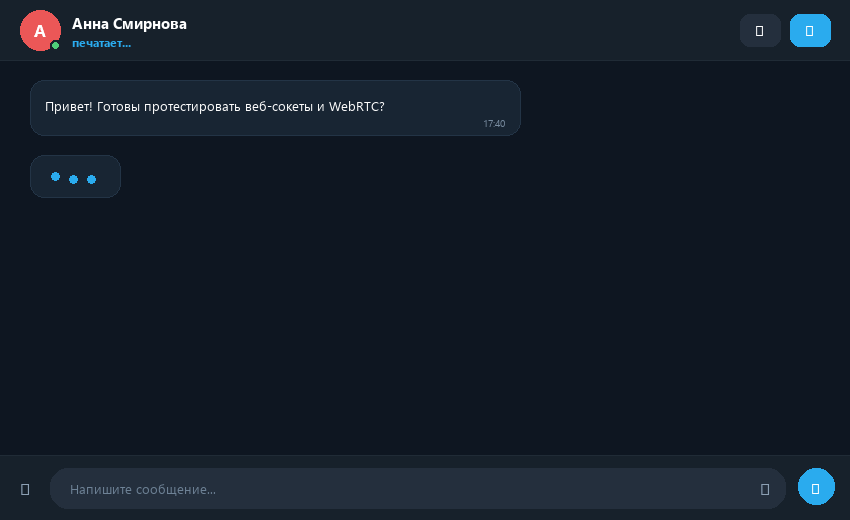
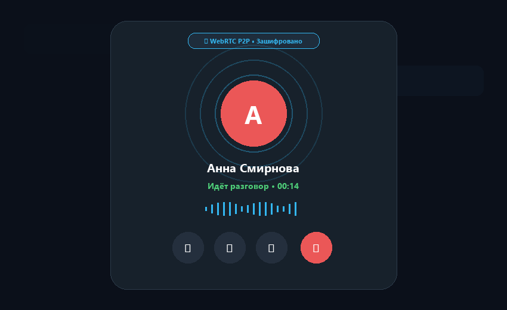
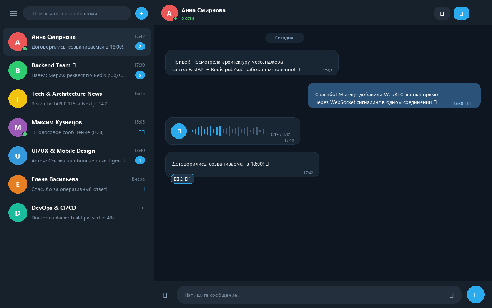
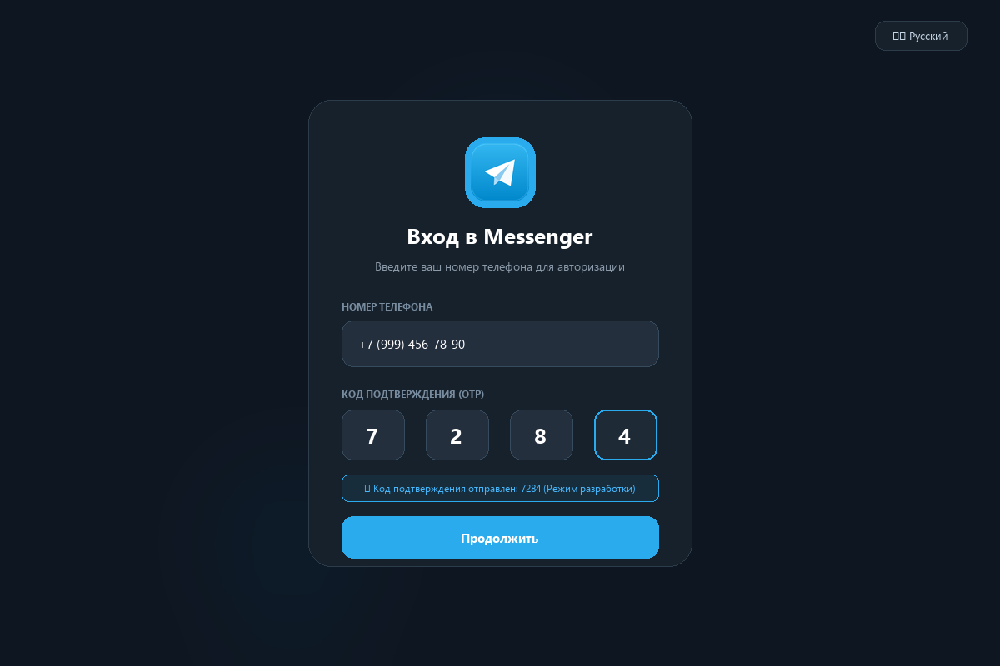

<div align="center">


# Messenger

**A Telegram-style real-time messenger** — 1-to-1 chats, groups & channels, media, and peer-to-peer audio/video calls.

*Built to explore real-time architecture: async FastAPI, Redis pub/sub fan-out across processes, and WebRTC signalling over a single WebSocket channel.*

[](https://www.python.org/)
[](https://fastapi.tiangolo.com/)
[](https://nextjs.org/)
[](https://www.postgresql.org/)
[](https://redis.io/)
[](#-testing)

</div>

---

## 🎬 Demo

<table>
  <tr>
    <td align="center" width="50%">
      <b>Real-time messaging</b><br/>
      <sub>delivery, typing indicators, read receipts</sub><br/><br/>
      
    </td>
    <td align="center" width="50%">
      <b>Audio &amp; video calls</b><br/>
      <sub>WebRTC signalled over WebSocket</sub><br/><br/>
      
    </td>
  </tr>
  <tr>
    <td align="center">
      <b>Chat list &amp; unread counts</b><br/><br/>
      
    </td>
    <td align="center">
      <b>Phone-number auth (OTP)</b><br/><br/>
      
    </td>
  </tr>
</table>

---

## ✨ Features

**Conversations**
- Three chat types — private, group and channel — with role-based permissions (`owner` / `admin` / `member`). In channels only admins can post.
- Text messages with **replies**, in-place **editing** and soft **deletion**.
- Media &amp; file attachments (image, video, audio, document) with server-side MIME validation and size limits.
- Cursor-based **history pagination** via `before_id`.

**Real-time**
- Live message delivery, typing indicators and read receipts.
- **Presence**: online/offline status that correctly handles multiple tabs and multiple server processes.
- A single WebSocket connection per app instance, with automatic reconnect and keep-alive ping.

**Calls**
- 1-to-1 audio and video calls using **WebRTC**, with the full `offer` / `answer` / `ice_candidate` handshake tunneled through the same WebSocket as chat events.
- Incoming-call banner, and signalling restricted to users who actually share a private chat.

**Auth**
- Passwordless **phone-number + OTP** sign-in — the flow Telegram made standard.
- JWT access tokens with **rotating refresh tokens**, stored in Redis.
- Automatic token refresh on `401` via an Axios interceptor, with the refreshed token propagated to the WebSocket layer.

---

## 🏗 Architecture

```
┌──────────────────┐         ┌──────────────────────────────────────────┐
│  Next.js 14      │  HTTP   │  FastAPI                                 │
│  (App Router)    │────────▶│  /api/v1/…                               │
│                  │         │                                          │
│  zustand store   │◀────────│  JWT · Pydantic schemas · services layer │
│  axios           │  WS     │                                          │
│                  │────────▶│  /ws  ──────────────┐                    │
└──────────────────┘         └───────────┬──────────┼───────────────────┘
                                          │          │
                              ┌───────────▼───┐  ┌───▼──────────────┐
                              │  PostgreSQL   │  │  Redis           │
                              │  (asyncpg)    │  │  • JWT refresh   │
                              │               │  │  • OTP codes     │
                              └───────────────┘  │  • pub/sub bus   │
                                                 └──────────────────┘
```

### Why Redis pub/sub instead of an in-memory connection map?

This was the interesting design problem. A naive gateway holds sockets in a process-local
`dict` — which breaks the moment you run more than one worker, because the sender and the
recipient land on different processes.

Instead, every event is **published to a Redis channel** (`user:{id}`), and each connection
runs its own listener that forwards messages arriving for that user. Delivery therefore works
across processes and can be scaled horizontally without sticky sessions:

```
sender ──▶ publish_to_user(bob) ──▶ Redis channel "user:{bob}"
                                          │
                        ┌─────────────────┴─────────────────┐
                     worker 1                           worker 2
                  (bob tab 1)                        (bob tab 2)
```

---

## 🧱 Tech stack

| Layer | Choices |
|---|---|
| **Backend** | FastAPI 0.115 · SQLAlchemy 2 (async) · asyncpg · Redis 7 · python-jose · phonenumbers |
| **Frontend** | Next.js 14 (App Router) · React 18 · TypeScript · Zustand · Axios · Tailwind CSS |
| **Infrastructure** | Docker Compose · PostgreSQL 16 · Redis 7 · Adminer |
| **Testing** | pytest · pytest-asyncio (37 tests) |

---

## 🚀 Quick start

The fastest way to see everything running is Docker Compose.

### 1. Configure secrets

```bash
cp .env.example .env
```

Then edit `.env` and set **`SECRET_KEY`** and **`POSTGRES_PASSWORD`** to your own values:

```bash
python -c "import secrets; print(secrets.token_urlsafe(48))"
```

> Compose refuses to start if these are unset, and the backend refuses to boot in production
> (`DEBUG=False`) with a default `SECRET_KEY`.

### 2. Launch

```bash
docker compose up --build
```

| Service | URL |
|---|---|
| Frontend | http://localhost:3000 |
| API docs (Swagger) | http://localhost:8000/docs |
| Adminer (DB UI) | http://localhost:8080 |

### 3. Sign in

`DEBUG=True` returns the OTP code directly in the `POST /auth/send-code` response, so no real
SMS is needed — the login screen even auto-fills it. Open **two browser windows**
(one incognito) with different phone numbers to watch real-time delivery and calls work.

---

## 🧑‍💻 Running without Docker

<details>
<summary><b>Backend</b></summary>

Requires Python 3.12, a running PostgreSQL and Redis.

```bash
cd backend
python -m venv .venv
source .venv/bin/activate      # Windows: .venv\Scripts\activate
pip install -r requirements.txt

cp .env.example .env           # then fill in DATABASE_URL, REDIS_URL, SECRET_KEY
uvicorn app.main:app --reload
```

Tables are created automatically on startup.

</details>

<details>
<summary><b>Frontend</b></summary>

```bash
cd frontend
npm install
npm run dev
```

</details>


---

## 📡 API surface

REST (all under `/api/v1`, JWT bearer except where noted) plus one WebSocket.

<details>
<summary><b>REST</b></summary>

| Method | Endpoint | Purpose |
|---|---|---|
| `POST` | `/auth/send-code` | Send an OTP to a phone number (no auth) |
| `POST` | `/auth/verify` | Exchange OTP for access + refresh tokens (no auth) |
| `POST` | `/auth/refresh` | Rotate tokens (no auth) |
| `GET` | `/users/me` | Current user profile |
| `PATCH` | `/users/me` | Update profile (username, display name, bio) |
| `POST` | `/users/me/avatar` | Upload an avatar |
| `GET` | `/users/search?q=` | Search users by name / username |
| `GET` | `/users/{user_id}` | Public profile |
| `GET` | `/chats` | List my chats (with last message + unread count) |
| `POST` | `/chats` | Create a private / group / channel chat |
| `GET` | `/chats/{chat_id}` | Fetch a single chat |
| `POST` | `/chats/{chat_id}/members/{user_id}` | Add a member (admin/owner only) |
| `POST` | `/chats/{chat_id}/read` | Mark the chat as read |
| `GET` | `/chats/{chat_id}/messages?before_id=` | Cursor-paginated history |
| `POST` | `/chats/{chat_id}/messages` | Send a text message |
| `POST` | `/chats/{chat_id}/messages/upload` | Send an attachment |
| `PATCH` | `/chats/{chat_id}/messages/{id}` | Edit my message |
| `DELETE` | `/chats/{chat_id}/messages/{id}` | Soft-delete my message |

</details>

<details>
<summary><b>WebSocket</b> — <code>/ws?token=...</code></summary>

**Client → server:** `send_message`, `typing_start`, `typing_stop`, `read`,
`call_offer`, `call_answer`, `ice_candidate`, `call_end`, `ping`.

**Server → client:** `new_message`, `message_edited`, `message_deleted`, `typing`,
`read_receipt`, `member_added`, `user_online`, `call_offer`, `call_answer`,
`ice_candidate`, `call_end`, `pong`, `error`.

The full handshake is documented in [`backend/app/ws/gateway.py`](backend/app/ws/gateway.py).

</details>

---

## 🗂 Project structure

<details>
<summary><b>Backend</b></summary>

```
backend/app/
├── main.py              # app wiring, CORS, routers, /uploads mount, /ws
├── core/
│   ├── config.py        # pydantic settings + startup safety checks
│   ├── database.py      # async engine + session factory
│   ├── redis.py         # async Redis client
│   ├── security.py      # JWT issue/verify
│   └── storage.py       # local file upload with MIME-based extensions
├── models/              # SQLAlchemy: User, Chat, ChatMember, Message
├── schemas/             # Pydantic request/response models
├── services/            # business logic (auth, chat, message) + deps
├── api/                 # REST routers
└── ws/gateway.py        # WebSocket: delivery, presence, call signalling
```

</details>

<details>
<summary><b>Frontend</b></summary>

```
frontend/
├── app/
│   ├── (auth)/login/    # phone + OTP flow
│   └── (main)/page.tsx  # chat shell, search, modals
├── components/chat/     # ChatList, ChatWindow, CallModal, IncomingCallBanner, …
├── context/             # WebSocketContext
├── hooks/useWebSocket.ts# single socket, reconnect, event → store
├── lib/api.ts           # Axios + 401 refresh interceptor
├── store/useStore.ts    # Zustand (auth + chat state)
└── types/               # shared TS types & WS event union
```

</details>

---

## 🔐 Security notes

Built with real-world concerns in mind, even as a portfolio piece:

- **Passwordless auth** — no passwords to leak. OTP codes live in Redis with a 5-minute TTL. In production, real SMS goes through Twilio (in `DEBUG` the code is returned in the API for local dev only).
- **Upload hardening** — server-side MIME allow-list, an SVG block-list (SVG can carry script → XSS), size caps, and file extensions derived from the *validated MIME type* rather than the client filename. `delete_file` guards against path traversal.
- **Authorization on every write** — chat membership is checked before posting / reading / typing; edits and deletes confirm the message belongs to the chat in the URL; call signalling requires the two users to actually share a private chat.
- **Input safety** — `ilike` search escapes `%` / `_` / `\` so user input can't break the `LIKE` pattern; malformed UUIDs in WS frames are rejected without dropping the connection.
- **Secrets** — Compose refuses to boot without `SECRET_KEY` / `POSTGRES_PASSWORD`, and the backend refuses to start in production with the default key. `.env` files are git-ignored.

**Known trade-offs** (left intentionally, listed honestly):
- `/uploads` is served unauthenticated — safe here only because filenames are unguessable UUIDs. In production I'd front it with signed URLs / a CDN.
- The JWT travels in the WebSocket query string (a browser WebSocket limitation). Production should use a short-lived ticket or a cookie.

---

## 🧪 Testing

```bash
cd backend
pytest
```

37 unit tests covering `SECRET_KEY` handling, the upload MIME allow-list / block-list,
extension mapping, JWT round-trips and UUID parsing. They caught real bugs while being
written — e.g. the SVG gap in the allow-list.

---

## 🗺 Roadmap / known limitations

- **Migrations** — the schema is currently created with `create_all()` on startup. Alembic is a dependency but not wired up; real schema evolution needs it.
- **Rich group/channel UI** — the WS + backend fully support groups & channels; the front-end leans toward the 1-to-1 experience.
- **End-to-end encryption** — messages are stored server-side; true E2E would be a major next step.
- **Push notifications** for offline users (the FCM slot was anticipated in the original design).

---

## 📄 License

Released under the [MIT License](LICENSE).

